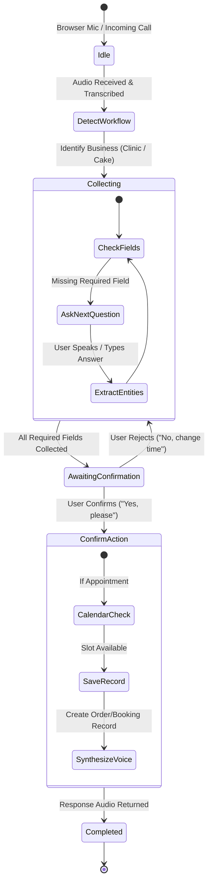

# MultiBusiness-VoiceAI (Voxly AI)

[](https://opensource.org/licenses/MIT)
[](https://fastapi.tiangolo.com)
[](https://react.dev)
[](https://www.typescriptlang.org)
[](https://vitejs.dev)
[](https://openai.com)
[](https://deepgram.com)
[](https://elevenlabs.io)
[](https://firebase.google.com)

**MultiBusiness-VoiceAI (Voxly AI)** is an enterprise-grade, multi-tenant conversational voice assistant and automation workspace designed for SMBs, healthcare practices (clinics, dental offices), retail bakeries, and customer-service teams.

It delivers real-time multimodal voice processing—combining browser-based microphone voice simulation, server-side speech transcription (STT), conversational slot-filling state machines, structured entity extraction with OpenAI GPT-4o, natural text-to-speech (TTS), Google Calendar OAuth scheduling, smart after-hours callback queues, and telephony gateway hooks (Exotel).

---

## Table of Contents

1. [System Architecture](#system-architecture)
2. [Technologies Used](#technologies-used)
3. [Key Capabilities](#key-capabilities)
4. [Complete Project Structure](#complete-project-structure)
5. [Multi-Business Domains & Workflows](#multi-business-domains--workflows)
6. [Interactive Voice Flow & State Machine](#interactive-voice-flow--state-machine)
7. [Database Schema & Persistence](#database-schema--persistence)
8. [Environment Configuration](#environment-configuration)
9. [Installation & Setup](#installation-setup)
10. [Running the Application](#running-the-application)
11. [Testing & Quality Assurance](#testing--quality-assurance)
12. [API Reference](#api-reference)

---

## System Architecture

The platform is designed with a **decoupled, provider-agnostic, dual-runtime architecture**:

```
+---------------------------------------------------------------------------------------+
|                                    CLIENT TIER                                        |
|                                                                                       |
|   +-------------------------------------------------------------------------------+   |
|   |                   React 18 + TypeScript SPA (Vite Dev / Prod)                 |   |
|   |                                                                               |   |
|   |  - Voice AI Dashboard & Real-Time Audio Recorder (MediaRecorder API)          |   |
|   |  - Visual Conversation Inspector & State Visualizer (Slot tracking)           |   |
|   |  - Interactive Workflow Simulator (English & Hindi en-IN / hi-IN)             |   |
|   |  - Callback Control System & After-Hours Operating Mode Management           |   |
|   |  - Calendar Synchronization & Appointment Management View                     |   |
|   +---------------------------------------+---------------------------------------+   |
+-------------------------------------------|-------------------------------------------+
                                            | HTTP REST / WebSockets / Audio Blobs
+-------------------------------------------v-------------------------------------------+
|                                    BACKEND TIER                                       |
|                                                                                       |
|   +-------------------------------------+   +-------------------------------------+   |
|   |        FastAPI Backend Server       |   |       Node.js / Express Gateway     |   |
|   |              (main.py)              |   |             (server.js)             |   |
|   |                                     |   |                                     |   |
|   |  * /api/ai/chat (Workflow Engine)   |   |  * Exotel Telephony Webhook adapter |   |
|   |  * /api/voice/simulate (Audio STT)  |   |  * WebSocket Live Audio Streaming   |   |
|   |  * /api/voice/synthesize (TTS)      |   |  * Node-based workflow testing      |   |
|   |  * Google Calendar OAuth2 Handler   |   |  * Phone normalization utilities    |   |
|   |  * In-memory Store / Firestore Sync |   |  * Fallback voice session router    |   |
|   +------------------+------------------+   +------------------+------------------+   |
+----------------------|-----------------------------------------|----------------------+
                       |                                         |
+----------------------v-----------------------------------------v----------------------+
|                           EXTERNAL SERVICES & AI PROVIDERS                            |
|                                                                                       |
|   +--------------------+  +--------------------+  +--------------------------------+  |
|   |      OpenAI        |  |     Deepgram       |  |          ElevenLabs            |  |
|   |     (GPT-4o)       |  |     (Nova-2)       |  |   (eleven_multilingual_v2)     |  |
|   | Strict JSON Schema |  |  Speech-to-Text    |  |     Text-to-Speech Streaming   |  |
|   | Entity Extraction  |  |  (REST/WebSocket)  |  |                                |  |
|   +--------------------+  +--------------------+  +--------------------------------+  |
|                                                                                       |
|   +--------------------+  +--------------------+  +--------------------------------+  |
|   |  Google Calendar   |  | Firebase Firestore |  |       Exotel Telephony         |  |
|   |    OAuth2 + v3     |  | Cloud Database &   |  |   Virtual Number, Call Webhook |  |
|   | Availability Check |  | Admin SDK Security |  |     and Missed-Call Queue      |  |
|   +--------------------+  +--------------------+  +--------------------------------+  |
+---------------------------------------------------------------------------------------+
```

---

## Technologies Used

### Frontend Stack

| Technology | Purpose | Description |
| :--- | :--- | :--- |
| **React 18 / 19** | User Interface | Component-driven declarative UI with hooks for state, audio playback, and visual inspectors |
| **TypeScript** | Type Safety | End-to-end interface typing for call records, conversations, workflow states, and settings |
| **Vite** | Build Tool & Bundler | Next-generation bundler with instant Hot Module Replacement (HMR) and optimized rollup production builds |
| **Lucide React** | Iconography | Crisp, modern icons for navigation, workflow cards, status pills, audio waves, and controls |
| **Web Audio / MediaRecorder API**| Audio Capture | Native browser microphone capture, audio blob encoding (WebM/WAV), and playback pipeline |
| **Firebase Client SDK** | Client Database | Optional client-side direct syncing and Firestore listener capabilities |

### Backend Stack

| Technology | Purpose | Description |
| :--- | :--- | :--- |
| **FastAPI (Python 3.11 - 3.13)** | Primary REST API | High-performance asynchronous API framework powering workflows, audio ingestion, and scheduling |
| **Uvicorn (ASGI)** | Server Runtime | Production-ready lightning-fast asynchronous server for Python |
| **Pydantic v2** | Data Validation | Strict schema enforcement, input validation, and serialization for request/response bodies |
| **Node.js & Express** | Auxiliary Gateway | Telephony event handling, raw WebSocket streaming (`ws`), and cross-runtime parity |
| **WebSocket (`ws`)** | Real-Time Audio | Bi-directional raw audio stream ingestion for live phone and microphone channels |
| **HTTPX** | Async HTTP Client | Asynchronous non-blocking HTTP requests to external AI APIs (Deepgram, ElevenLabs, Google OAuth) |
| **Google Cloud Firestore / Firebase Admin** | Persistence Tier | NoSQL document storage with document merge, collection indexing, and role-based security rules |
| **Python-Dotenv** | Config Management | Environment-specific secret and credential loading |

### AI, Speech & Telephony Integrations

| Service | Category | Functionality |
| :--- | :--- | :--- |
| **OpenAI GPT-4o** | Large Language Model | Structured output schema extraction (`json_schema` mode) to pull entities and intents with zero hallucinations |
| **Deepgram Nova-2** | Speech-to-Text (STT) | Low-latency audio-to-text transcription with punctuation, Indian accent recognition, and bilingual support |
| **ElevenLabs** | Text-to-Speech (TTS) | High-fidelity neural voice synthesis (`eleven_multilingual_v2`) for lifelike customer-facing conversational replies |
| **Google Calendar API v3** | Calendar Integration | FreeBusy query checks and automated event insertion with customer attendee notifications |
| **Exotel Telephony API** | Telephony Gateway | Virtual numbers, inbound call webhooks (`/api/voice/incoming`), call status updates, and audio bridging |

---

## Key Capabilities

1. **Dual Voice Modes (Browser Simulator + Real Telephony)**
   - **Browser Simulator**: Record your voice directly in Chrome, Edge, or Safari using standard Web APIs. The backend transcribes your query, advances the workflow state machine, and replies with synthesized audio or browser text-to-speech fallback.
   - **Telephony Ready**: Built-in Exotel webhooks track caller phone numbers, call duration, status (`RINGING`, `ANSWERED`, `MISSED`, `COMPLETED`), and bridge audio into the workflow engine.

2. **Multi-Tenant Business Support**
   - Built-in business templates for **Mangalore Smile Clinic** (Healthcare/Dental) and **Sweet Crumbs Cake Shop** (Bakery/Retail).
   - Easily extensible to real estate, salons, auto services, and restaurants.

3. **Intelligent Slot Filling & Entity Extraction**
   - Dual extraction engine: deterministic regex + keyword parser backed by OpenAI GPT-4o structured JSON Schema.
   - Automatically handles relative dates (`today`, `tomorrow`, `next Monday`), times (`4 PM`, `11:30 am`), patient names, phone numbers, cake flavors, weights (`2kg`), and delivery preferences.
   - Preserves pre-captured caller IDs from telephony or session metadata so callers don't need to re-enter their phone number.

4. **Multi-Language & Indian Dialect Support**
   - Seamlessly operates in **English (`en-IN`)** and **Hindi (`hi-IN`)**.
   - Native Hindi workflow questions, translations, and bilingual entity matching (e.g., *चॉकलेट*, *कल*, *डिलीवरी*).

5. **Automated Callback & Operating Hours Engine**
   - Configurable modes: `always`, `during_hours`, or `after_hours`.
   - Automatically detects missed calls and enqueues callbacks with customer context, priority, and timestamps based on business hours.

6. **Google Calendar Synchronization**
   - Full OAuth2 authorization flow with automatic refresh token persistence.
   - Performs automated availability checks before confirming bookings to eliminate double-booking conflicts.

7. **Zero-Dependency Local Fallback**
   - Runs out-of-the-box without requiring active Firebase, ElevenLabs, or Deepgram accounts.
   - Features an in-memory dictionary store structured identically to Firestore collections for immediate local testing.

---

## Complete Project Structure

```
MultiBusiness-VoiceAI/
│
├── .gitignore                      # Git exclusion rules (keeps .env, venv, node_modules private)
├── README.md                       # Comprehensive project documentation (this file)
│
├── backend/                        # Backend Application Tier
│   ├── .env.example                # Template for environment variables and API keys
│   ├── firestore.rules             # Production security rules for Firebase Firestore
│   ├── main.py                     # Primary FastAPI application (Endpoints, Workflows, STT/TTS)
│   ├── package.json                # Node.js dependencies for the auxiliary Express/telephony service
│   ├── package-lock.json           # Lockfile for Node.js backend packages
│   ├── requirements.txt            # Python dependencies (FastAPI, Uvicorn, Pydantic, OpenAI, Firebase)
│   ├── server.js                   # Express + WebSocket server for Exotel telephony and streaming
│   ├── workflows.js                # CommonJS workflow definitions and normalization engine
│   │
│   ├── services/                   # Modular service adapters
│   │   ├── ai/
│   │   │   └── workflowEngine.js   # Conversation state manager, slot parser, and question selector
│   │   ├── calendar/
│   │   │   └── googleCalendarService.js # Google Calendar OAuth2, FreeBusy, and event creation
│   │   ├── speech/
│   │   │   ├── speechToText.js     # Deepgram WebSocket/REST transcription adapter
│   │   │   └── textToSpeech.js     # ElevenLabs neural TTS audio synthesis adapter
│   │   └── telephony/
│   │       ├── ExotelProvider.js   # Exotel IVR, call initiation, and webhook payload parsing
│   │       └── TelephonyProvider.js # Base abstract class for telephony providers
│   │
│   ├── test/                       # Backend test suites
│   │   ├── test_main.py            # Pytest suite for FastAPI endpoints, phone logic, and slots
│   │   └── workflow.test.js        # Node.js unit tests for workflow transitions and parsing
│   │
│   └── utils/                      # Shared helper functions
│       └── phone.js                # International and Indian phone number formatting (+91)
│
├── docs/                           # Architecture and schema documentation
│   ├── architecture.md             # High-level architecture notes and boundary definitions
│   └── database-schema.md          # Comprehensive Firestore NoSQL collections and field specs
│
└── frontend/                       # Frontend Application Tier (Single Page Application)
    ├── .env.example                # Frontend environment configuration template
    ├── index.html                  # HTML5 entry page with responsive viewport settings
    ├── package.json                # Frontend dependencies (React, Vite, Lucide, Firebase)
    ├── package-lock.json           # Lockfile for frontend npm packages
    ├── tsconfig.json               # TypeScript compiler configuration
    ├── vite.config.ts              # Vite server and build configuration
    │
    └── src/                        # React TypeScript source files
        ├── AuthPages.tsx           # Authentication screens (Login, Signup, Onboarding, Forgot Password)
        ├── CallbackSystemControl.tsx # Floating widget to toggle and inspect after-hours callback states
        ├── VoiceAiPage.tsx         # Voice AI control center (Microphone recorder, Call logs, Audio player)
        ├── main.tsx                # Application shell, navigation sidebar, dashboard, and AI simulator
        ├── styles.css              # Global styling, modern typography, glassmorphism, responsive grid
        ├── workflow.css            # Workflow builder and card component styling
        ├── conversation.css        # Chat bubbles, live audio visualizer, and inspector styling
        ├── vite-env.d.ts           # Vite client environment typing definitions
        │
        ├── config/
        │   └── firebase.ts         # Firebase client initialization and auth/database bindings
        │
        └── services/
            └── firestore.ts        # Firestore CRUD methods for conversations, appointments, and orders
```

---

## Multi-Business Domains & Workflows

### 1. Healthcare: Mangalore Smile Clinic

- **Intent**: `book_appointment`, `reschedule_appointment`, `cancel_appointment`, `appointment_enquiry`
- **Fields Collected**:
  1. `patient_name` (Patient's full name)
  2. `phone_number` (Contact number, auto-populated from caller ID)
  3. `doctor_or_specialty` (e.g., Dentist, Orthodontics, General Dentistry, Cleaning)
  4. `preferred_date` (e.g., `tomorrow`, `2026-09-10`)
  5. `preferred_time` (e.g., `10:00 AM`, `4 PM`)
  6. `reason_for_visit` (Optional notes, e.g., "tooth pain")
- **Action**: Verifies Google Calendar availability, saves appointment to database, and presents confirmation.

### 2. Retail & Bakery: Sweet Crumbs Cake Shop

- **Intent**: `cake_order`, `custom_cake_enquiry`, `order_status`, `cake_enquiry`
- **Fields Collected**:
  1. `customer_name` (Customer's name)
  2. `phone_number` (Contact number)
  3. `cake_flavor` (e.g., Chocolate, Red Velvet, Vanilla, Butterscotch, Black Forest)
  4. `cake_type` (e.g., Birthday cake, Wedding cake, Custom photo cake)
  5. `weight_kg` (e.g., `1.5`, `2`)
  6. `delivery_method` (`pickup` or `delivery`)
  7. `delivery_address` (Conditional: required only if delivery is selected)
  8. `required_date` (Date needed)
- **Action**: Flags urgency (`URGENT` for same-day/next-day orders), generates order ID, and stores record.

---

## Interactive Voice Flow & State Machine



---

## Database Schema & Persistence

The project supports both Firestore in the cloud and an in-memory dictionary for zero-setup local execution:

| Collection | Key Attributes | Description |
| :--- | :--- | :--- |
| `businesses` | `id`, `name`, `type`, `hours`, `timezone`, `specialties` | Business profile and config |
| `workflows` | `id`, `businessId`, `name`, `intent`, `fields[]` | Defined conversational flow schemas |
| `conversations`| `id`, `businessId`, `transcript[]`, `collected_data`, `state`, `priority` | Full session history and slot values |
| `appointments` | `id`, `patient_name`, `doctor_or_specialty`, `preferred_date`, `preferred_time`, `status` | Confirmed medical appointments |
| `cakeOrders` | `id`, `customer_name`, `cake_flavor`, `weight_kg`, `delivery_method`, `priority` | Bakery and custom cake orders |
| `voiceCalls` | `id`, `callerPhone`, `status`, `durationSeconds`, `transcript[]`, `summary` | Telephony and browser voice sessions |
| `missedCalls` | `id`, `callerPhone`, `timestamp`, `callbackStatus`, `reason` | Missed call queue entries |
| `callbackSettings`| `enabled`, `mode`, `business_hours_start`, `business_hours_end`, `timezone` | Dynamic after-hours callback rules |
| `calendarTokens`| `id`, `refresh_token`, `scope`, `created_at` | Encrypted Google Calendar OAuth tokens |

---

## Environment Configuration

### Backend (`backend/.env`)

Create `backend/.env` from `backend/.env.example`:

```bash
# Server Port & Public Domain
PORT=8000
FRONTEND_ORIGINS=http://localhost:5173,http://127.0.0.1:5173
BACKEND_PUBLIC_URL=https://your-domain.ngrok-free.app
VOICE_WS_URL=wss://your-domain.ngrok-free.app/api/voice/stream

# Speech-to-Text (STT) Provider (Deepgram Nova-2)
STT_PROVIDER=deepgram
STT_API_KEY=your_deepgram_api_key_here
STT_WS_URL=wss://api.deepgram.com/v1/listen?encoding=mulaw&sample_rate=8000&channels=1&interim_results=true&endpointing=300

# Text-to-Speech (TTS) Provider (ElevenLabs)
TTS_PROVIDER=elevenlabs
TTS_API_KEY=your_elevenlabs_api_key_here
TTS_VOICE_ID=JBFqnCBsd6RMkjVDRZzb
TTS_MODEL=eleven_multilingual_v2

# Large Language Model (OpenAI)
OPENAI_API_KEY=your_openai_api_key_here
OPENAI_MODEL=gpt-4o

# Google Calendar Integration (OAuth 2.0)
GOOGLE_CLIENT_ID=your_google_client_id.apps.googleusercontent.com
GOOGLE_CLIENT_SECRET=your_google_client_secret
GOOGLE_REDIRECT_URI=http://127.0.0.1:8000/api/calendar/oauth/callback
GOOGLE_REFRESH_TOKEN=
GOOGLE_CALENDAR_ID=primary
BUSINESS_TIMEZONE=Asia/Kolkata

# Telephony Integration (Exotel - Optional)
EXOTEL_ACCOUNT_SID=your_exotel_account_sid
EXOTEL_API_KEY=your_exotel_api_key
EXOTEL_API_TOKEN=your_exotel_token
EXOTEL_BASE_URL=https://api.exotel.com

# Firebase Firestore (Optional - runs in-memory if omitted)
GOOGLE_APPLICATION_CREDENTIALS=C:/path/to/firebase-service-account.json
FIREBASE_PROJECT_ID=your_firebase_project_id
```

### Frontend (`frontend/.env`)

Create `frontend/.env` from `frontend/.env.example`:

```bash
VITE_API_BASE_URL=http://127.0.0.1:8000

# Firebase Web Client (Optional)
VITE_FIREBASE_API_KEY=
VITE_FIREBASE_AUTH_DOMAIN=
VITE_FIREBASE_PROJECT_ID=
VITE_FIREBASE_STORAGE_BUCKET=
VITE_FIREBASE_MESSAGING_SENDER_ID=
VITE_FIREBASE_APP_ID=
```

---

## Installation & Setup

### Prerequisites

- **Python 3.11+** installed (`python --version`)
- **Node.js 18+** & **npm** installed (`node --version`, `npm --version`)
- Git installed (`git --version`)

### 1. Clone the Repository

```bash
git clone https://github.com/JAGDISHPOOJARY-41/MultiBusiness-VoiceAI.git
cd MultiBusiness-VoiceAI
```

### 2. Configure Backend Virtual Environment

```bash
cd backend
python -m venv .venv

# On Windows (PowerShell):
.\.venv\Scripts\Activate.ps1

# On macOS/Linux:
source .venv/bin/activate

pip install -r requirements.txt
npm install
cd ..
```

### 3. Install Frontend Dependencies

```bash
cd frontend
npm install
cd ..
```

---

## Running the Application

### Option A: Run the Primary FastAPI Backend

```bash
cd backend
# Ensure virtualenv is activated
uvicorn main:app --reload --port 8000
```
*The FastAPI backend will start at `http://127.0.0.1:8000` with interactive Swagger docs at `http://127.0.0.1:8000/docs`.*

### Option B: Run the Express / Telephony Gateway (Optional)

```bash
cd backend
node server.js
```

### Option C: Run the Frontend Development Server

In a new terminal window:

```bash
cd frontend
npm run dev
```
*Open `http://localhost:5173` in Google Chrome or Microsoft Edge.*

### Using the Browser Voice AI Simulator

1. Navigate to **Voice AI** in the dashboard navigation sidebar.
2. Click **Start conversation**.
3. Allow browser microphone access when prompted.
4. Speak naturally (e.g., *"I'd like to book an appointment with a dentist for tomorrow at 4 PM, my name is Rahul."*).
5. The audio is captured, sent to `/api/voice/simulate`, processed through the workflow state machine, and returned with assistant speech playback!

---

## Testing & Quality Assurance

The codebase includes comprehensive test suites across both runtimes:

### Run Python Pytest Suite

```bash
cd backend
pytest test/
```

### Run Node.js Test Runner

```bash
cd backend
npm test
```

### Verify Frontend TypeScript & Production Build

```bash
cd frontend
npm run build
```

---

## API Reference

### Conversational Workflow & Voice

- `POST /api/ai/chat`: Process a text conversation turn, extract slots, update state, and trigger fulfillment actions.
- `POST /api/voice/simulate`: Multipart audio upload endpoint (`audio/webm` or `wav`). Transcribes speech via Deepgram and executes a workflow turn.
- `POST /api/voice/synthesize`: Returns streaming binary MP3 audio for any input text via ElevenLabs.
- `POST /api/voice/sessions`: Start or update a voice session record.
- `GET /api/voice/settings`: Retrieve assistant configuration (name, active language, speech provider status).

### Telephony Gateway (Exotel)

- `POST /api/voice/incoming`: Webhook receiving incoming call notifications.
- `POST /api/voice/status`: Webhook tracking call lifecycle events (`ANSWERED`, `MISSED`, `COMPLETED`).
- `GET /api/voice/calls`: List recorded phone and simulator calls.
- `GET /api/voice/missed-calls`: List missed call queue with callback status.

### Google Calendar Integration

- `GET /api/calendar/auth-url`: Generate Google OAuth2 authorization URL.
- `GET /api/calendar/oauth/callback`: OAuth2 code exchange and refresh token capture.
- `GET /api/calendar/availability`: Check FreeBusy availability slots for a date range.
- `POST /api/calendar/events`: Programmatically create calendar events.

### Callback & Business Settings

- `GET /api/callback-settings`: Get after-hours callback configuration.
- `PUT /api/callback-settings`: Update operating hours, timezone, and callback rules.
- `GET /api/analytics`: Aggregate statistics (conversations, completion rates, urgent tasks).

---

## License

This project is licensed under the MIT License - see the LICENSE file for details.
